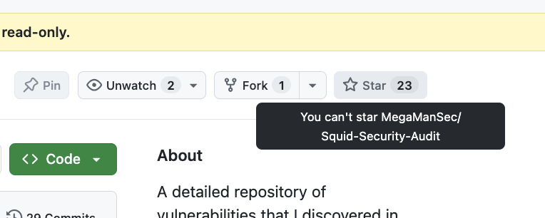

I like to archive my popular, but "finished" GitHub repositories, for two main reasons:

1. If my SSH key ever gets stolen, it limits the damage that an attacker can do to my popular GitHub repositories,
2. Those repositories are, as far as I consider, "finished", and will no longer get updates.

You can't star archived GitHub repositories anymore, however. You can fork the repository and then star the fork, but it's no longer possible to star the original.

|  |
|:--:|
| *"You can't star MegaManSec/Squid-Security-Audit"* |

This also means you can no longer _un-star_ an archived repository. This was reported back [in August](https://github.com/orgs/community/discussions/203738), but it seems that this "feature" has been rolled out to more users since then.

In order to achieve something similar (an archived but still public repository which will be useful for others), I've instead set up these repositories to:

1. Disallow pushing to any branch (with a ruleset),
2. Disallow creating issues, PRs, discussions, etc.,
3. Disable Actions.

How annoying.
