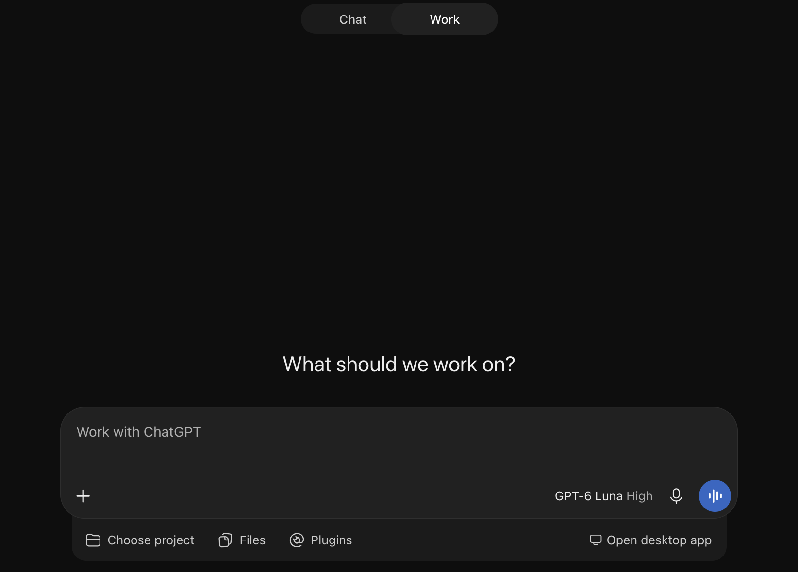
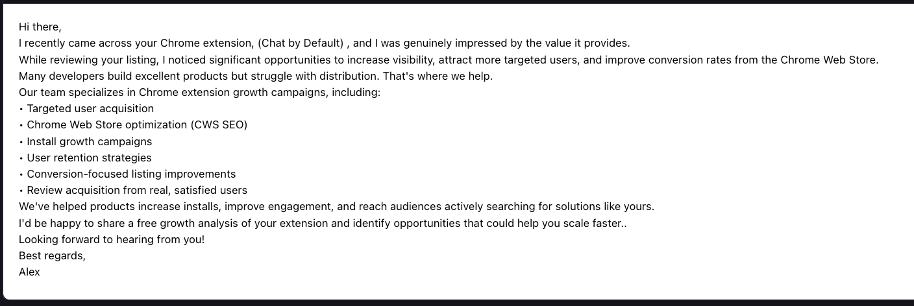

In congruence with my typical fight against ~~the world~~ annoying UX that makes me think the designers of products don't _want_ their users to be happy, today's fight is with enterprise ChatGPT. For those with ChatGPT accounts that also have "ChatGPT Work" access, chances are that when you open the homepage of ChatGPT, you get immediately put into Work mode, which takes quite a long time to load -- and is much slower than the normal Chat mode (since it has to load up an entire VM).

|  |
|:--:|
| *"What should we work on?" Nothing, thank you for your attention to this matter.* |

Whether you get Chat or Work mode by default depends on two things: 1. a server-side experiment, and 2. a client-side cookie. If Work mode is the default, it means the server is telling you to use Work. If you pick Chat, the cookie only remembers that choice for four hours (and some accounts seemingly ignore it completely); after those 4 hours, ChatGPT will load in Work mode again. This is... extremely annoying for someone who does not want to use Work mode at all, like me.

Anyways, I tested various ways to get the website to always use Chat mode, but nothing really worked. So instead, I made a very simple browser extension which supports Chrome, Firefox, and Safari (even on iOS!). It's [really small](https://github.com/MegaManSec/ChatGPT-Chat-By-Default/blob/main/src/content.ts). The plugin watches the page for changes and automatically clicks the Chat button whenever Work mode becomes active -- unless it detects that the user deliberately selected Work.

- Firefox Add-ons: <https://addons.mozilla.org/en-US/firefox/addon/chat-by-default/>
- Chrome Web Store: <https://chromewebstore.google.com/detail/chat-by-default/fdfndhmkmdcmbnfhkdnmbddhdiidopod>
- App Store (macOS and iOS): <https://apps.apple.com/us/app/chat-by-default/id6832335375>

The code is open source [on GitHub](https://github.com/MegaManSec/ChatGPT-Chat-By-Default) -- all 79 lines of it (plus the hundreds related to building and publishing to the various extension stores).

Probably the most interesting part of this... exercise (publishing the extension to each of the add-on stores, which includes the App Store) was signing up to the Chrome Web Store and the App Store.

The Chrome Web Store sign-up was simple enough: you literally pay $5USD, and you gain access. You can submit 2 extensions for review, and apparently (based on online discussion), you can request more when you hit that limit. The Chrome Web Store's developer dashboard is amazingly janky, with divs overflowing, and images with visible pixel-by-pixel borders. I don't know how long it took from first submission to acceptance, because Google... doesn't notify you when an extension goes live, apparently, and there's nowhere to view this information in the admin panel (it's probably available _somewhere_ though). The first version went in by hand on November 11, and according to the GitHub Actions log, 1.0.1 replaced it at 16:33 UTC on November 12. I noticed it was live about 27 hours after that. Since the extension only has a single `content_script` which only matches `https://chatgpt.com/*`, maybe this is the low end of how long it normally takes for extensions (especially new ones?) to be accepted/published. The update to 1.0.2, by contrast, was being served by Chrome's update server within 15 minutes of the upload.

The first submission to Firefox Add-ons took 6 hours and 7 minutes. Subsequent submissions take about 3 minutes.

The first submission to the App Store (for Safari on macOS and iOS) took a bit longer, and that was just for the app. I recently paid $99USD and went through the verification process of getting a developer account in Apple's ecosystem, so I could publish [Magic Switch](https://joshua.hu/magic-switch-easily-switch-magic-keyboard-trackpad-mouse-between-mac-macbook-macos) in the App Store. That was generally fine, and like the Chrome Web Store, the website is quite... low-tech (loading screens to get to next stages, popups (!!!), and some other funny things that you totally wouldn't expect from Apple). Also Apple doesn't allow you to create a developer account if your account is associated with a country but has a recovery phone number from a _different_ country (based on the country code of the recovery phone number), and the thrilling registration experience will fail with "We are unable to process your request. An unknown error occurred." But it's generally OK. Subsequent submissions take about 12 hours.

As soon as the extension was published on the Chrome Web Store, I received this email, from someone who, I can only assume, is not Google:

|  |
|:--:|
| *"Review acquisition from real, satisfied users."* |

I take that as a "good luck, I wish you success".

---

P.S. In reality, defaulting to Work mode is likely because OpenAI bills _usage_ in Work mode, whereas Chat mode is covered by the subscription.
