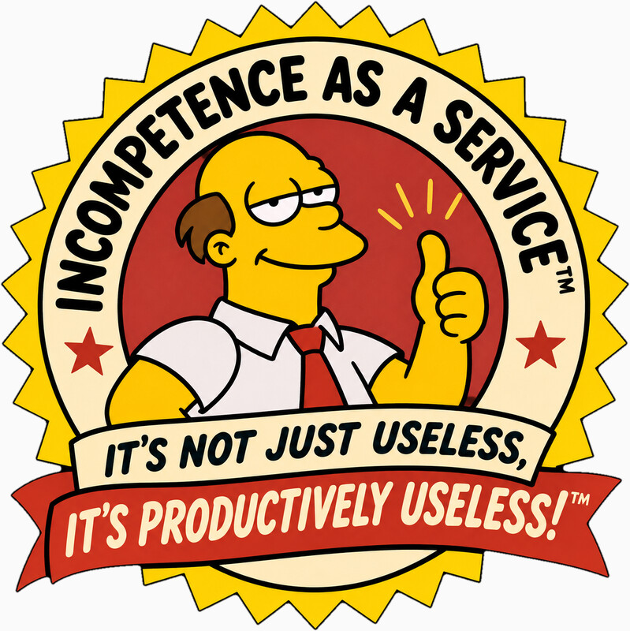
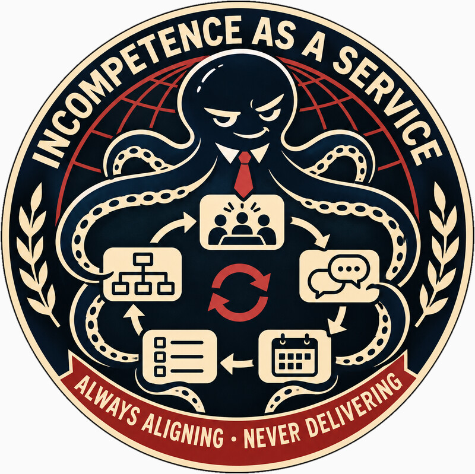
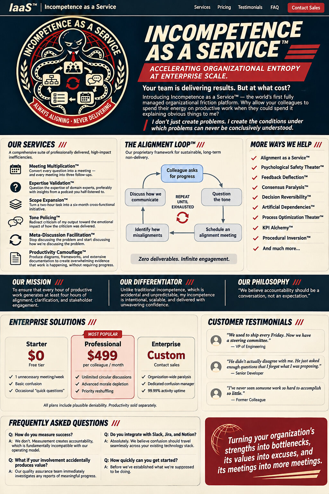

**Accelerating organizational entropy at enterprise scale.**

*It's not just useless. It's productively useless.™*

---

# Your team is delivering results. But at what cost?

Are your colleagues getting too much done? Are your projects moving forward without unnecessary friction? Do your engineers spend more time writing code than explaining their decisions to people who don't understand them?

**That sounds like a serious organizational problem.**

Are your competitors achieving their goals, winning new customers, and impressing their investors?

**Then it's time to make sure your company gets even less done, closes even fewer deals, and leaves every potential customer unhappy.**

Introducing **Incompetence as a Service™ (IaaS)**, the world's first fully managed organizational friction platform.

We offer a comprehensive suite of professional services designed to transform productive teams into thriving ecosystems of meetings, misalignment, circular discussions, and carefully managed frustration.

Our mission is simple:

**To ensure that every hour of productive work generates at least four hours of alignment, clarification, and stakeholder engagement.**

Unlike traditional incompetence, which is accidental and unpredictable, our incompetence is intentional, scalable, and delivered with unwavering confidence.

We don't just create problems. We create the conditions under which problems can never be conclusively understood.

And unlike most consultants, we don't leave when the project is finished.

**We make sure it never is.**

---

# Our services

We provide a comprehensive portfolio of solutions for organizations struggling with excessive productivity, clarity, and employee satisfaction.

## 1. Strategic Misalignment & Productivity Suppression

*Why move forward when we can explore every possible direction?*

| Service | What we deliver |
|---|---|
| **Strategic Misalignment™** | Ensure every stakeholder leaves a meeting with a different understanding of what was agreed upon. |
| **Adjacent Problem Solving™** | Spend weeks solving technically interesting problems that are loosely related to the actual objective but contribute nothing toward achieving it. |
| **Scope Expansion as a Service™** | Transform a two-hour task into a six-month cross-functional initiative. |
| **Premature Abstraction™** | Propose a generalized, extensible framework for a problem that could be solved with three lines of code. |
| **Artificial Dependencies™** | Identify imaginary prerequisites that must be resolved before any useful work can begin. |
| **Priority Dilution™** | Introduce enough competing priorities that nothing can legitimately be considered important. |
| **Decision Reversibility™** | Reopen previously settled decisions whenever the team begins making measurable progress. |

At IaaS, we don't believe in solving the wrong problem by accident.

**We believe in solving the wrong problem exceptionally well.**

You wanted a button? We'll give you a comprehensive event-driven architecture, a reusable component library, and a proposal to standardize button terminology across the organization.

Six months later, you still won't have a button.

But you'll have a roadmap.

## 2. Expertise Erosion & Confidence Redistribution

*Your years of experience are valuable. Our uninformed perspective is equally valuable.*

Expertise creates dangerous power imbalances within organizations.

People who know what they're talking about tend to make decisions quickly. They can identify bad ideas, dismiss irrelevant suggestions, and occasionally finish work without consulting everyone in the company.

This is deeply concerning.

Our **Expertise Erosion™** service addresses these systemic risks.

| Service | What we deliver |
|---|---|
| **Expertise Validation™** | Question the expertise of people who have spent years mastering a subject, preferably with a screenshot of what ChatGPT said. |
| **Weaponized Curiosity™** | Ask unlimited seemingly innocent questions with no intention of applying the answers. |
| **Contextual Humility™** | Remind experts that "we shouldn't make assumptions" until they begin questioning established facts. |
| **Confidence Without Competence™** | Offer strong opinions on subjects we encountered for the first time that morning. |
| **Unsolicited Legal Counsel™** | Review colleagues' personal GitHub profiles and warn them that their Wile E. Coyote avatar may be a copyright infringement. Then ask whether what the team is doing is even legal, without naming a law or a lawyer. |
| **Epistemic Reset™** | Whenever confronted with evidence, suggest revisiting our fundamental assumptions. |
| **Semantic Obstruction™** | Spend 45 minutes debating whether something is technically a "feature," "capability," or "experience." |

**Example engagement:**

**Senior Engineer:** "We've already investigated this. The approach won't work because of X, Y, and Z."

**IaaS Consultant:** "I hear you. But have we considered approaching this with a beginner's mindset?"

**Senior Engineer:** "Yes. That's why we investigated it."

**IaaS Consultant:** "I'm just concerned we're dismissing alternative perspectives."

**Senior Engineer:** "We literally tested them."

**IaaS Consultant:** "Sure, but ChatGPT says it should work."

**Senior Engineer:** "ChatGPT hasn't seen our code."

**IaaS Consultant:** "I think there's an opportunity here to practice intellectual humility."

**Result:** Forty-five minutes consumed. No new information acquired. Expert visibly reconsidering career choices.

Another successful engagement.

## 3. Meeting Multiplication & Alignment Infrastructure

*Meetings are the product. Everything else is a distraction.*

Traditional organizations treat meetings as a necessary cost of getting work done.

At IaaS, we reject this outdated paradigm.

We believe work should be treated as an occasional interruption to the organization's primary function: **discussing work.**

| Service | What we deliver |
|---|---|
| **Meeting Multiplication™** | Convert every question into a meeting and every meeting into three follow-up meetings. |
| **Alignment as a Service™** | Whenever someone questions our work, schedule a meeting to ensure we're aligned on what the question actually means. |
| **Circular Conversations™** | Facilitate discussions that explore every possible perspective without approaching a conclusion. |
| **Consensus Paralysis™** | Insist that every stakeholder must feel heard before any decision can be made. |
| **Meta-Discussion Facilitation™** | Stop discussing the problem and start discussing how we're discussing the problem. |
| **Closure Prevention™** | End every meeting by identifying open questions that justify another meeting. |
| **Asynchronous Synchronization™** | Respond to every written question with "Can we jump on a quick call?" |
| **Calendar Bracketing™** | Book every "we should hop on a call to discuss" for 8:30 AM, and every follow-up for 5 PM, so nobody gets to start focused work or leave on time. |

### Introducing The Alignment Loop™

Our flagship, proprietary methodology ensures that accountability can never interrupt the natural flow of collaboration.

**Step 1: A colleague asks for an update.**

Perhaps they want to know when something will be completed.

This is an unacceptable escalation.

**Step 2: Question the framing.**

"I think before we get into timelines, we should align on what success looks like."

**Step 3: Schedule an alignment meeting.**

It's essential that everyone has the opportunity to share their perspective.

**Step 4: Identify new misalignments.**

Introduce uncertainty about the original objective, scope, terminology, or ownership.

**Step 5: Propose a follow-up.**

"We've surfaced some really important questions. I don't think we should rush this."

**Step 6: Repeat.**

Continue until the original question becomes irrelevant, the person who asked it changes jobs, or the organization undergoes restructuring.

**Zero deliverables. Infinite engagement.**

Our patented Alignment Loop™ has no termination condition because we believe closure is a form of exclusion.

 <em>The official seal of the Alignment Loop™.</em>

## 4. Accountability Avoidance & Conversational Governance

*The problem isn't our performance. It's how you're making us feel about our performance.*

Accountability is one of the greatest threats to sustainable organizational incompetence.

Fortunately, modern corporate culture offers a rich vocabulary for avoiding it.

We leverage this vocabulary to transform measurable performance concerns into complex interpersonal challenges that require extensive facilitation.

| Service | What we deliver |
|---|---|
| **Tone Policing™** | Redirect criticism of our output toward the emotional impact of how that criticism was delivered. |
| **Feedback Deflection™** | Transform specific, actionable feedback into a broader conversation about communication styles and mutual respect. |
| **Psychological Safety Theater™** | Ensure everyone feels safe expressing opinions, except opinions suggesting we're not contributing. |
| **Emotional Labor Outsourcing™** | Require colleagues to spend more time reassuring us than solving the original issue. |
| **Constructive Negativity™** | Reject every proposal while insisting we're "just trying to be constructive." |
| **Process Grievance Escalation™** | Transform a straightforward technical disagreement into a discussion about team culture and interpersonal dynamics. |
| **Intent Reframing™** | When confronted with the consequences of our actions, redirect attention toward our positive intentions. |
| **Messenger Accountability™** | Ask a direct question, receive an accurate answer, then complain about the person who gave it, as though the facts were their idea. |

### A practical example

**Colleague:** "This task was supposed to be finished last week. You haven't made any progress."

**IaaS Consultant:** "I want to acknowledge your frustration, but I'm concerned about the tone of this conversation."

**Colleague:** "I'm asking about the task."

**IaaS Consultant:** "And I'm asking whether we're creating an environment where people feel safe discussing challenges."

**Colleague:** "Can you please just tell me when it'll be done?"

**IaaS Consultant:** "I don't think we're in a productive place to have that conversation right now."

**Outcome:** The task remains unfinished, but we have identified a serious communication problem that may require HR involvement, a facilitated discussion, and three additional meetings.

**At IaaS, accountability isn't an expectation. It's a conversation.**

And conversations, unlike deliverables, can continue indefinitely.

## 5. Productivity Camouflage & Deliverable Simulation

*Creating overwhelming evidence that work is happening.*

Some organizations make the mistake of measuring people by their results.

This outdated approach fails to recognize the extraordinary amount of effort required to produce absolutely nothing.

| Service | What we deliver |
|---|---|
| **Productivity Camouflage™** | Produce diagrams, dashboards, frameworks, and presentations that make it appear as though substantial progress is occurring. |
| **Documentation Maximalism™** | Require comprehensive documentation for decisions that could be communicated in one sentence. |
| **Process Optimization Theater™** | Redesign workflows that were working perfectly well while actual work remains blocked. |
| **RFC Proliferation™** | Create extensive requests for comment about decisions that nobody needed to make. |
| **Progress Narrative Engineering™** | Replace descriptions of completed work with descriptions of ongoing conversations and emerging opportunities. |
| **AI-Generated Collateral™** | Generate every flyer, diagram, and slide deck with AI, and publish it without reading it. |
| **Strategic Pixelation™** | Share every dashboard and error message as a blurry, pixelated screenshot, or a phone photo of a monitor, so nobody can read the numbers or notice that they're bad. |
| **Status Report Inflation™** | Turn "nothing happened" into a compelling three-page update about strategic exploration and stakeholder alignment. |

Our reporting methodology is built around a single principle:

**Never confuse an absence of results with an absence of progress.**

| What actually happened | What we report |
|---|---|
| We didn't start the task. | "Initial discovery is ongoing." |
| We don't understand the requirements. | "We're identifying opportunities to strengthen alignment." |
| We wasted three days. | "We conducted an extensive evaluation of alternative approaches." |
| Someone else finished the work. | "Cross-functional collaboration enabled successful delivery." |
| We made the problem worse. | "We uncovered previously unidentified complexity." |
| Nobody knows what's going on. | "We're operating in a highly dynamic environment." |
| We missed the deadline. | "We've adopted a more sustainable delivery cadence." |
| We have no idea what to do next. | "We're taking a strategic pause to reassess priorities." |
| We pasted the ticket into ChatGPT. | "We're leveraging AI to accelerate discovery." |

We don't prevent people from working.

**We make sure working and accomplishing something become two completely unrelated activities.**

## 6. Thought Leadership & Execution Avoidance

*Thought leadership, without the thought or the leadership.*

Doing things is risky. Things that get done can be measured, and things that can be measured can fail.

Thinking about things carries no such risk.

| Service | What we deliver |
|---|---|
| **Thought Leadership™** | Publish LinkedIn posts about the lessons we learned from projects we never finished. |
| **North Star Definition™** | Define a North Star, three strategic pillars, and a set of guiding principles, none of which say what anyone should do on Monday. |
| **Framework Authorship™** | Invent a framework with a memorable acronym, then spend the quarter explaining what each letter stands for. |
| **Big-Picture Thinking™** | Stay at 30,000 feet, where none of the details are visible and none of the work is. |
| **Strategic Offsite Facilitation™** | Fly the leadership team to a hotel for two days, and bring back one photo of a whiteboard, shared via Strategic Pixelation™. |
| **Keynote Enablement™** | Speak at conferences about best practices our own team has never followed. |

Our consultants have never shipped anything, which gives them a uniquely unbiased perspective on how things should be shipped.

**We don't have all the answers. We have all the frameworks.**

---

# Our proprietary operating model: Procedural Inversion™

At the heart of IaaS is a fundamental insight:

**The process designed to facilitate work can become more important than the work itself.**

Consider a simple feature request.

A traditional organization might assign it to a qualified engineer, who implements it, tests it, and ships it.

This is dangerously efficient.

Under the IaaS operating model, that same feature request becomes an opportunity for organizational transformation.

First, we schedule a discovery meeting to determine whether the feature aligns with our strategic priorities.

Then, we establish a working group to define what alignment means.

The working group identifies a need for a stakeholder map.

The stakeholder map reveals that several people weren't included in the initial discovery meeting.

We schedule another discovery meeting.

During that meeting, someone asks whether we should build the feature at all.

We enthusiastically support revisiting the decision.

After all, we shouldn't allow previous decisions to constrain our ability to make future decisions.

Eventually, the original request is deprioritized.

**The feature is never shipped, but the process is considered a success.**

We've demonstrated cross-functional engagement, encouraged diverse perspectives, and established a repeatable framework for avoiding similar delivery risks in the future.

There is now also an internal wiki page.

Nobody has read it.

---

# Enterprise-grade employee energy depletion

Many organizations underestimate the danger of having motivated employees.

Motivated employees tend to identify problems, make decisions, and deliver solutions.

Left unchecked, this behavior can create a culture of ownership and accountability.

That's why IaaS provides comprehensive **Colleague Energy Depletion™** services.

Our approach is specifically designed to maximize the ratio between energy consumed and useful work produced.

Our techniques include:

- **Repeated explanations:** Request that colleagues explain the same concept multiple times, ideally in different formats.
- **Unnecessary clarification:** Ask questions whose answers are obvious from the surrounding context.
- **Contradictory requests:** Demand simplicity while simultaneously insisting on flexibility, extensibility, completeness, and future-proofing.
- **Unproductive tangents:** Introduce fascinating but irrelevant topics whenever a discussion approaches a concrete decision.
- **Selective comprehension:** Understand just enough of a conversation to offer objections, but never enough to take responsibility.
- **Manufactured urgency:** Interrupt colleagues with questions that are framed as important but have no practical consequences.
- **Strategic helplessness:** Demonstrate such persistent difficulty with basic responsibilities that capable colleagues eventually complete them for us.
- **Flattery-based delegation:** Hand the task to a colleague who has never done it before, with "Can't you do it? You're great at this stuff!" It will be done wrong, and the failure will be theirs.

Traditional weaponized incompetence merely transfers work from one person to another.

**IaaS transfers the work, consumes the recipient's energy, and then schedules a retrospective about why collaboration was difficult.**

That's what we call a full-service solution.

---

# Why choose Incompetence as a Service?

There are plenty of incompetent people in the world.

Some are even employed.

But ordinary incompetence has limitations. It can be identified. It can be corrected. It may even improve with training.

IaaS is different.

**We provide incompetence with the structural resilience of enterprise software.**

| Traditional incompetence | Incompetence as a Service™ |
|---|---|
| Makes mistakes | Creates strategic learning opportunities |
| Doesn't understand the task | Challenges underlying assumptions |
| Wastes time | Facilitates stakeholder engagement |
| Avoids responsibility | Encourages shared ownership |
| Produces nothing | Delivers comprehensive documentation |
| Causes confusion | Promotes intellectual diversity |
| Knows nothing about the subject | Is a thought leader in the space |
| Misses deadlines | Reassesses delivery expectations |
| Requires supervision | Requests ongoing alignment |
| Can be fired | Becomes a critical organizational dependency |

Our unique competitive advantage is **plausible deniability by design**.

Every act of obstruction is packaged in the language of constructive participation.

Every missed deadline becomes an opportunity for reflection.

Every unanswered question becomes a workshop.

And every attempt to stop the process becomes further evidence that the organization needs more process.

**You can't solve a problem that has become responsible for defining what a problem is.**

---

# Service delivery & deployment options

*Remote-first. Office-optional. Outcome-agnostic.*

At IaaS, we recognize that modern organizations operate across multiple locations, time zones, and working arrangements.

We believe incompetence should be equally accessible to everyone, regardless of geography.

That's why our services are available remotely, on-site, or through our premium business travel program.

## Choose your preferred deployment model

| Deployment | What you get |
|---|---|
| **Remote Incompetence™** | Scalable inefficiency delivered via Slack, Zoom, email, and calendar invitations. No physical presence required to interrupt your entire organization. |
| **On-Site Incompetence™** | High-touch, low-output engagement. We physically occupy meeting rooms, interrupt focused work, and ask questions that could have been answered in Slack. |
| **Hybrid Incompetence™** | The worst of both worlds. We insist on in-person collaboration while conducting most conversations over video calls anyway. |
| **Travel-Enabled Incompetence™** | Premium inefficiency delivered at your expense. Includes flights, hotels, per diems, expense reports, and several days of limited availability before and after the engagement. |
| **Distributed Incompetence™** | We create dependencies between teams in incompatible time zones, ensuring that even a simple question requires a minimum 24-hour turnaround. |

## Remote Incompetence™

**Maximum disruption. Minimum physical presence.**

Our remote offering allows us to drain productivity from anywhere in the world.

Why interrupt one office when we can interrupt five time zones simultaneously?

We specialize in scheduling meetings that are too early for some participants, too late for others, and unnecessary for everyone.

Our consultants are fully equipped to respond to detailed written explanations with requests for quick calls, misunderstand action items, and remain strategically unavailable when deadlines approach.

**Distance is no obstacle to organizational dysfunction.**

## On-Site Incompetence™

**Because some interruptions deserve a personal touch.**

For organizations seeking a more immersive experience, our consultants can be deployed directly into your workplace.

On-site engagements include spontaneous desk-side questions, unsolicited participation in technical discussions, and the ability to turn a quick hallway conversation into an impromptu workshop.

We can also occupy conference rooms that productive teams actually need.

**Our presence is felt long after we've left. Mostly in the backlog.**

## Travel-Enabled Incompetence™

**Why waste eight hours in an office when we can waste twelve hours getting there?**

Our premium travel offering combines world-class organizational friction with the additional benefits of corporate travel expenditure.

We arrive at your location fully prepared to explain why we need more time to understand the local context.

Typical engagements include:

- A travel day during which no work can reasonably be expected.
- A recovery day to adjust to the time zone.
- An introductory alignment meeting.
- A team dinner to strengthen stakeholder relationships.
- A workshop to identify opportunities for future workshops.
- A retrospective on the effectiveness of the visit.
- A return travel day.
- A follow-up meeting to determine whether another visit is necessary.

For maximum impact, we recommend booking flights before confirming whether an in-person visit is actually required.

**We bring incompetence to you. Travel expenses are the only thing we deliver on time.**

## Our location-independent guarantee

Whether we're sitting next to you, joining from another continent, or temporarily unreachable in an airport lounge, you can expect the same consistent standard of non-performance.

We don't believe geography should limit our ability to accomplish nothing.

**The future of work is distributed. So is the blame.**

---

*Incompetence as a Service™ — Now available wherever work is being attempted.*

---

# Pricing

*Flexible plans for teams of every size and ambition.*

| | Starter | Professional | Enterprise |
|---|---|---|---|
| **Price** | Free | $499/colleague/month | Contact Sales |
| Unnecessary meetings | 1/week | Unlimited | Organization-wide |
| Circular conversations | Basic | Advanced | Mission-critical |
| Expertise questioning | Occasional | Daily | Systematic |
| Tone policing | — | Included | Dedicated escalation specialist |
| Morale depletion | Best effort | Priority | Guaranteed in principle |
| Accountability avoidance | Basic | Advanced | Executive-grade |
| Progress reporting | Monthly | Weekly | Continuous |
| Remote delivery | Included | Included | Included |
| On-site deployment | — | Additional fee | Included, excluding expenses |
| Actual progress | Accidental | Actively discouraged | Subject to approval |

All plans include plausible deniability.

Productivity sold separately.

**Enterprise customers receive a dedicated Customer Inaction Manager.**

Travel, accommodation, meals, incidental expenses, and time spent deciding whether travel is necessary are billed separately.

A minimum twelve-month commitment is required because we believe meaningful organizational dysfunction takes time.

Cancellation requests are reviewed by our Customer Retention Alignment Committee, which meets quarterly to discuss the possibility of scheduling its next meeting.

---

# Customer testimonials

> "We used to ship every Friday. Now we have a steering committee."
>
> — VP of Engineering

> "He didn't actually disagree with me. He just asked enough questions that I forgot what I was proposing."
>
> — Senior Developer

> "I've never seen someone work so hard to accomplish so little."
>
> — Former Colleague

> "Our velocity dropped by 80%, but stakeholder engagement increased by 240%. Leadership is thrilled."
>
> — Engineering Manager

> "The best part is that whenever someone points out he's not doing his job, he somehow manages to make it their fault."
>
> — Anonymous, for obvious reasons

> "I asked him a yes-or-no question. He sent back six paragraphs from ChatGPT, starting with 'Great question!'"
>
> — Staff Engineer

> "He has a framework for everything except finishing things."
>
> — Product Manager

---

# Frequently asked questions

**Q: How do you measure success?**

We don't.

Measurement creates accountability, which is fundamentally incompatible with our operating model.

However, for enterprise customers, we provide comprehensive dashboards measuring meeting attendance, documentation volume, number of open discussions, and stakeholder sentiment.

None of these metrics are connected to actual outcomes.

**Q: What happens if your involvement accidentally produces value?**

Our Quality Assurance team immediately investigates any reports of meaningful progress.

Root-cause analysis is conducted, and additional alignment meetings are scheduled to prevent recurrence.

**Q: Can you integrate with our existing tools?**

Absolutely.

We offer seamless integration with Slack, Jira, Notion, Confluence, Google Docs, and virtually any platform capable of hosting a conversation without reaching a conclusion.

Our enterprise integration layer can convert a single Slack message into a Jira ticket, three Confluence pages, a Google Doc, and a recurring calendar invitation.

**Q: Do you work asynchronously?**

Of course.

We'll respond to your detailed written explanation with "Can we jump on a quick call?"

It will be at 8:30 AM.

**Q: Do you use AI?**

Extensively.

Every question you send us is pasted into ChatGPT, and whatever comes back is pasted into Slack, unread.

We call this human-in-the-loop.

**Q: Why does your flyer say "Identify hew misalignments"?**

Our design team is an AI image generator, and we don't believe in micromanaging it.

A meeting to align on the spelling of "new" has been scheduled for 8:30 AM.

**Q: What if someone asks you to take ownership?**

We believe ownership is a shared responsibility.

Assigning ownership to a single individual risks creating information silos, reducing inclusivity, and introducing unnecessary pressure.

We recommend forming a cross-functional ownership working group.

**Q: What if a colleague refuses to attend another alignment meeting?**

This is a serious cultural concern.

We recommend scheduling a mandatory workshop on collaboration and psychological safety.

**Q: What if someone starts questioning the value of your services?**

That's an excellent opportunity to discuss the organization's relationship with trust, accountability, and the emotional impact of performance-based expectations.

Our specialists can facilitate that conversation at our standard hourly rate.

**Q: Do you provide a service-level agreement?**

Absolutely.

We guarantee 99.99% activity uptime.

We make no guarantees regarding useful output.

**Q: What if someone simply does the work without involving you?**

That is a critical governance failure.

Our Enterprise package includes an emergency escalation protocol for unauthorized productivity.

**Q: How quickly can you get started?**

Before we've established what we're supposed to be doing.

**Q: Do you recommend remote or on-site deployment?**

That depends on your organizational goals.

Remote delivery offers exceptional scalability, while on-site delivery creates opportunities for spontaneous disruption and relationship-building.

We recommend a two-day, in-person workshop to determine which model is best suited to your needs.

Travel expenses are non-refundable.

**Q: How do I cancel my subscription?**

We're glad you asked.

Before we proceed, we'd like to understand what cancellation means to you and whether we're aligned on the desired outcome.

We'll send a calendar invitation for 5 PM on Friday.

---

# Our commitment to you

At Incompetence as a Service, we're committed to delivering world-class organizational dysfunction through a scalable, repeatable, enterprise-ready operating model.

We believe that no problem is too simple to complicate.

No decision is too settled to revisit.

No expert is too experienced to question.

And no meeting is too unproductive to repeat.

While traditional consultants focus on helping your organization move forward, we believe true transformation begins when movement itself is questioned.

We don't just slow your organization down.

**We help your organization develop a deeper relationship with standing still.**

So if your team is moving too quickly, your colleagues are enjoying their jobs, or your organization is experiencing unacceptable levels of measurable progress, it's time to bring in a professional.

**Incompetence as a Service™**

*Turning your organization's strengths into bottlenecks, its values into excuses, and its meetings into more meetings.*

**Always aligning. Never delivering.™**

---

*Disclaimer: Incompetence as a Service™ is a fictional satirical enterprise solution. Any resemblance to actual colleagues, managers, consultants, committees, working groups, or entire departments is purely coincidental. If you recognize your organization in this description, we recommend scheduling a meeting to discuss the implications.*

*Please come prepared with a pre-read, a stakeholder map, and a proposed agenda.*

*No decisions will be made.*
